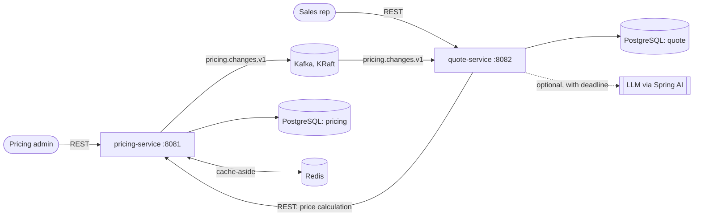

# PriceForge: Architecture

> **This file owns** how PriceForge is built: services, Maven modules, package layout, repo file
> tree, data model, Kafka topics and event schemas, API contracts, caching, the LLM integration,
> local runtime and memory budget, testing, CI, deployment topology and pinned versions.
> **It must stay consistent with the accepted ADRs** in [adr/](adr/README.md). What and why are in
> [SPEC.md](SPEC.md). Task status is in [TASKS.md](TASKS.md).
> Precedence: SPEC > accepted ADRs > ARCHITECTURE > TASKS > chat.

**Status:** Approved 2026-10-11

## 1. Overview



- There are two Spring Boot services. Infrastructure is one PostgreSQL server holding one database
  per service, one Kafka broker in KRaft mode, and one Redis.
- quote-service calls pricing-service over synchronous REST. pricing-service tells quote-service
  about changes through Kafka events ([ADR-0003](adr/0003-service-boundaries-and-communication.md)).
- The same Compose file runs everything locally and, for demos, on a single AWS Lightsail instance
  ([ADR-0009](adr/0009-aws-deployment-target.md)).

## 2. Services

| | pricing-service | quote-service |
| --- | --- | --- |
| Owns (SPEC §3.1) | Product, PriceList, PriceListEntry, DiscountRule | Quote, QuoteLine, QuoteHistoryEntry |
| Features (SPEC §5) | F-1 to F-6 | F-7 to F-10 |
| HTTP port | 8081 | 8082 |
| Database | `pricing` (user `pricing`) | `quote` (user `quote`) |
| Kafka | Produces `pricing.changes.v1` | Consumes `pricing.changes.v1` (group `quote-service`) |
| Redis | Price-lookup cache | None |
| Outbound calls | None | pricing-service REST; optionally an LLM |

## 3. Maven modules ([ADR-0002](adr/0002-monorepo-maven-multi-module.md))

| Module | Packaging | Contents | Depends on |
| --- | --- | --- | --- |
| root `pom.xml` (`priceforge-parent`) | pom | Inherits `spring-boot-starter-parent` 4.1.1, imports `spring-ai-bom` 2.0.1, plugin configuration, module list | none |
| `contracts` | jar | Everything that crosses the service boundary: `Segment`, `Category`, the price-calculation request and response records, `PricingChangedEvent`, topic names. No Spring, no JPA, no logic. | none |
| `pricing-service` | jar (Boot app) | See §4 | `contracts` |
| `quote-service` | jar (Boot app) | See §4 | `contracts` |

- **groupId:** `dev.priceforge`. **Base package:** `dev.priceforge`.
- **Build:** always use the Maven Wrapper (`./mvnw`), pinned to Maven 3.10.0. Never use the system
  Maven (3.6.3).
- **Versions:** don't declare a version for anything the Boot or Spring AI BOMs manage (§16).

## 4. Package layout

Packages are organised by feature. Inside a feature the layers are controller → service →
repository. The pricing engine is plain Java, so it can be unit-tested without Spring.

**pricing-service** (`dev.priceforge.pricing`)

| Package | Holds |
| --- | --- |
| `catalog` | Product entity, repository, service, controller, DTOs (F-1) |
| `pricelist` | PriceList and PriceListEntry, activation (F-2) |
| `rule` | DiscountRule (F-3) |
| `engine` | The SPEC §4.1 algorithm as plain Java: no Spring, no JPA, no I/O. It takes a list price, candidate rules, quantity and cap, and returns a breakdown. |
| `calculation` | Price-calculation endpoint and service. It loads inputs through the cache and calls `engine` (F-4). |
| `events` | Builds pricing-change events with their SPEC §4.3 scope and publishes them (F-5, ADR-0006) |
| `cache` | Redis cache configuration and the cache error handler (F-6, ADR-0007) |
| `web` | Problem Details handling and shared web configuration (F-11) |

**quote-service** (`dev.priceforge.quote`)

| Package | Holds |
| --- | --- |
| `quote` | Quote, QuoteLine, QuoteHistoryEntry, lifecycle, controller (F-7, F-9) |
| `pricingclient` | `RestClient` to pricing-service, timeouts, error mapping (F-7) |
| `staleness` | Kafka listener, idempotency check, scope matching (F-8) |
| `explanation` | Fallback explainer and the deadline-bound LLM call (F-10, ADR-0008) |
| `web` | Problem Details handling (F-11) |

## 5. Repository file tree (end of v1)

```text
priceforge/
├── .github/workflows/
│   ├── ci.yml                      # build + all tests on push and PR
│   └── images.yml                  # build and push images to GHCR (manual or tag)
├── .mvn/wrapper/maven-wrapper.properties
├── mvnw, mvnw.cmd
├── pom.xml                         # priceforge-parent
├── .editorconfig, .gitignore, .env.example
├── compose.yaml                    # infra always; apps behind the "apps" profile
├── infra/postgres/init/            # creates the pricing and quote databases and users
├── contracts/
│   ├── pom.xml
│   └── src/{main,test}/java/dev/priceforge/contracts/...   (+ test JSON fixtures)
├── pricing-service/
│   ├── pom.xml, Dockerfile
│   └── src/main/{java/dev/priceforge/pricing/..., resources/{application.yaml, db/migration/}}
│       src/test/java/...
├── quote-service/                  # same shape as pricing-service
├── deploy/aws/                     # deploy.sh, teardown.sh, verify-teardown.sh, user-data.sh, RUNBOOK.md
├── demo/                           # seed.sh (demo data through the API) and the demo script
├── docs/
│   ├── SPEC.md, ARCHITECTURE.md, TASKS.md, PROGRESS.md
│   └── adr/                        # README.md (index) + NNNN-title.md
├── CLAUDE.md
├── LICENSE
└── README.md
```

Demo data (the SPEC §4.2 product and rules) is loaded through the public API by `demo/seed.sh`,
never by migrations. That keeps the test and production schemas free of data.

## 6. Data model

**Conventions**
- One Flyway migration set per service, in `src/main/resources/db/migration`, named `V<n>__<what>.sql`.
- Money is `numeric(12,2)` for unit prices and `numeric(14,2)` for totals. It maps to `BigDecimal`,
  never `double`. Percentages are `numeric(5,2)`.
- Timestamps are `timestamptz`, in UTC. Enums are stored as `varchar` with a `CHECK` listing the
  allowed values.
- Every mutable aggregate root has a `version bigint` column for JPA optimistic locking.
- Tests never use H2. Partial unique indexes and `jsonb` behave differently there, so all database
  tests run on real PostgreSQL through Testcontainers.

### 6.1 `pricing` database

**product**

| Column | Type | Constraints |
| --- | --- | --- |
| id | bigint identity | PK |
| sku | varchar(64) | not null, unique |
| name | varchar(200) | not null |
| category | varchar(32) | not null, CHECK in Category values |
| active | boolean | not null, default true |
| version, created_at, updated_at | bigint, timestamptz, timestamptz | not null |

**price_list**

| Column | Type | Constraints |
| --- | --- | --- |
| id | bigint identity | PK |
| code | varchar(32) | not null, unique |
| name | varchar(200) | not null |
| currency | char(3) | not null |
| status | varchar(16) | not null, CHECK in (DRAFT, ACTIVE, RETIRED) |
| activated_at | timestamptz | null |
| version, created_at, updated_at | | not null |

- A **partial unique index on `status` where `status = 'ACTIVE'`** guarantees at most one ACTIVE
  list, even under concurrent activations.

**price_list_entry**

| Column | Type | Constraints |
| --- | --- | --- |
| id | bigint identity | PK |
| price_list_id | bigint | not null, FK → price_list |
| product_id | bigint | not null, FK → product |
| unit_price | numeric(12,2) | not null, CHECK > 0 |
| | | unique (price_list_id, product_id) |

**discount_rule**

| Column | Type | Constraints |
| --- | --- | --- |
| id | bigint identity | PK |
| code | varchar(64) | not null, unique |
| description | varchar(300) | not null |
| segment | varchar(32) | null, CHECK in Segment values |
| category | varchar(32) | null, CHECK in Category values |
| min_quantity | integer | null, CHECK ≥ 1 |
| percent_off | numeric(5,2) | not null, CHECK > 0 and < 100 |
| priority | integer | not null |
| exclusive_group | varchar(32) | null |
| active | boolean | not null |
| version, created_at, updated_at | | not null |

### 6.2 `quote` database

**quote**

| Column | Type | Constraints |
| --- | --- | --- |
| id | uuid | PK, generated by the application |
| customer_name | varchar(200) | not null |
| segment | varchar(32) | not null, CHECK |
| status | varchar(16) | not null, CHECK in (PRICED, STALE, ACCEPTED); indexed |
| currency | char(3) | not null |
| price_list_code | varchar(32) | not null |
| priced_at | timestamptz | not null |
| list_total, net_total | numeric(14,2) | not null |
| version, created_at, updated_at | | not null |

**quote_line**

| Column | Type | Constraints |
| --- | --- | --- |
| id | bigint identity | PK |
| quote_id | uuid | not null, FK → quote |
| line_no | integer | not null, unique (quote_id, line_no) |
| sku | varchar(64) | not null |
| product_name | varchar(200) | not null (snapshot) |
| category | varchar(32) | not null (snapshot; used for the §7 scope match) |
| quantity | integer | not null, CHECK 1–100000 |
| unit_list_price, unit_net_price | numeric(12,2) | not null (snapshot) |
| line_total | numeric(14,2) | not null (snapshot) |
| breakdown | jsonb | not null: the `steps` array exactly as pricing-service returned it |

**quote_history_entry**

| Column | Type | Constraints |
| --- | --- | --- |
| id | bigint identity | PK |
| quote_id | uuid | not null, FK → quote |
| type | varchar(32) | not null, CHECK in (CREATED, PRICING_CHANGED, REPRICED, ACCEPTED) |
| occurred_at | timestamptz | not null |
| cause_event_id | uuid | null; set for PRICING_CHANGED |
| details | varchar(500) | null |
| | | unique (quote_id, cause_event_id) |

- PostgreSQL treats NULLs as distinct in a unique constraint. So many CREATED and REPRICED rows
  (with a NULL cause) can exist per quote, but each event can appear only once per quote.

**processed_event** (idempotent consumer, §7.3)

| Column | Type | Constraints |
| --- | --- | --- |
| event_id | uuid | PK |
| event_type | varchar(64) | not null |
| processed_at | timestamptz | not null |

## 7. Kafka

### 7.1 Topics ([ADR-0005](adr/0005-kafka-topic-design.md))

| Topic | Partitions | Replication | Retention | Key | Producer → consumer |
| --- | --- | --- | --- | --- | --- |
| `pricing.changes.v1` | 3 | 1 (single broker) | 7 days | event `subject` | pricing-service → quote-service |
| `pricing.changes.v1-dlt` | 3 (must be ≥ source) | 1 | 30 days | same as source | quote-service error handler → people |

- Topics are declared by the application. Broker auto-creation is disabled, so a misspelled topic
  name fails loudly.

### 7.2 Event: `PricingChangedEvent`, schema version 1 ([ADR-0004](adr/0004-event-schema-format.md))

```json
{
  "eventId": "2f9c3a8e-5b7d-4c1e-9a0f-6d2b8e4c7a11",
  "eventType": "DISCOUNT_RULE_CHANGED",
  "schemaVersion": 1,
  "occurredAt": "2026-11-02T10:15:30Z",
  "subject": "discount-rule:CAT-FASTENERS-3",
  "change": "UPDATED",
  "scope": { "allSegments": true, "segments": [], "allCategories": false, "categories": ["FASTENERS"] },
  "summary": "CAT-FASTENERS-3: percent off 3.00 -> 4.00"
}
```

| Field | Type | Meaning |
| --- | --- | --- |
| eventId | UUID | Unique per change. The consumer deduplicates on it. |
| eventType | `PRICE_LIST_ACTIVATED` or `DISCOUNT_RULE_CHANGED` | |
| schemaVersion | int | `1`. Only additive changes are allowed within a version. |
| occurredAt | ISO-8601 UTC instant | When the change was made |
| subject | `price-list:<code>` or `discount-rule:<code>` | Also the Kafka record key, so events for the same subject stay in order |
| change | `ACTIVATED`, `CREATED`, `UPDATED` or `DEACTIVATED` | Price lists only ever send `ACTIVATED` |
| scope | object | SPEC §4.3. When `allSegments` is true, `segments` is empty; the same holds for categories. A price-list activation has everything set to "all". |
| summary | string, ≤ 200 chars | Copied into the quote's PRICING_CHANGED history entry |

### 7.3 Behaviour (ADR-0005, [ADR-0006](adr/0006-event-publishing-consistency.md))

**Producer (pricing-service)**
- The event is built and sent inside the same database transaction as the change. The send waits
  for the broker's acknowledgement (`priceforge.pricing.publish-timeout`, 5 s).
- If the send fails, the change rolls back and the API returns 503 `event-publish-failed`.
- Producer settings: `acks=all`, idempotent producer. Type-info headers are off; the serializer is
  `JacksonJsonSerializer`.

**Consumer (quote-service)** handles each record in one database transaction:
1. Insert `processed_event(eventId)`. If that row already exists, this event was handled before:
   skip it.
2. Select quotes in PRICED or STALE whose segment is in scope and that have at least one line with
   a category in scope.
3. For each quote: if it's PRICED, set it to STALE. Then insert a PRICING_CHANGED history entry
   with `cause_event_id = eventId` and `details = summary`.
4. Commit. The container commits the Kafka offset after the listener returns.

**Error handling**
- Deserialization: `ErrorHandlingDeserializer` wraps `JacksonJsonDeserializer`, with the default
  value type set to the contract record. A deserialization failure is fatal, so the record goes
  straight to the DLT.
- Other errors: `DefaultErrorHandler` with a fixed back-off of 1 s and 2 retries (3 attempts in
  all), then `DeadLetterPublishingRecoverer` publishes to `pricing.changes.v1-dlt`. Spring Kafka's
  own default would be 10 attempts with no delay.
- An optimistic-lock conflict (for example, the quote was accepted at the same moment) is retried.
  On the retry the quote is ACCEPTED, so it's no longer affected.

## 8. REST API contracts

**Conventions**
- JSON over HTTP. The base path is `/api/v1`. No authentication (SPEC §6).
- Money is a JSON number with exactly 2 decimals, read into `BigDecimal`. Percentages are numbers
  with 2 decimals.
- Timestamps are ISO-8601 UTC. Enums are uppercase strings.
- Lists are paged with `page` (0-based) and `size` (default 20, max 100). The response is our own
  page shape, not a framework type: `{content, page, size, totalElements, totalPages}`.
- A `201` response carries a `Location` header.
- Actuator exposes only `/actuator/health`, including its liveness and readiness groups.

### 8.1 pricing-service (port 8081)

| Method | Path | Purpose | Success | Feature |
| --- | --- | --- | --- | --- |
| POST | `/api/v1/products` | Create `{sku, name, category}` | 201 | F-1 |
| GET | `/api/v1/products/{sku}` | Read one | 200 | F-1 |
| GET | `/api/v1/products` | List, paged | 200 | F-1 |
| PATCH | `/api/v1/products/{sku}` | Change `{name?, active?}` | 200 | F-1 |
| POST | `/api/v1/price-lists` | Create a DRAFT `{code, name, currency}` | 201 | F-2 |
| GET | `/api/v1/price-lists/{code}` | Read, with entries | 200 | F-2 |
| GET | `/api/v1/price-lists` | List, paged | 200 | F-2 |
| PUT | `/api/v1/price-lists/{code}/entries/{sku}` | Set `{unitPrice}` (DRAFT only) | 200 | F-2 |
| DELETE | `/api/v1/price-lists/{code}/entries/{sku}` | Remove an entry (DRAFT only) | 204 | F-2 |
| POST | `/api/v1/price-lists/{code}/activate` | Activate. Emits an event. | 200 | F-2, F-5 |
| POST | `/api/v1/discount-rules` | Create. Emits an event. | 201 | F-3, F-5 |
| GET | `/api/v1/discount-rules/{code}` | Read one | 200 | F-3 |
| GET | `/api/v1/discount-rules?active=` | List, paged | 200 | F-3 |
| PUT | `/api/v1/discount-rules/{code}` | Replace every field except `code`, including `active`. Emits an event unless only `description` changed. | 200 | F-3, F-5 |
| POST | `/api/v1/price-calculations` | `{segment, lines:[{sku, quantity}]}` returns a breakdown | 200 | F-4 |

### 8.2 quote-service (port 8082)

| Method | Path | Purpose | Success | Feature |
| --- | --- | --- | --- | --- |
| POST | `/api/v1/quotes` | Create and price `{customerName, segment, lines:[{sku, quantity}]}` | 201 | F-7 |
| GET | `/api/v1/quotes/{id}` | Read, with lines and history | 200 | F-7 |
| GET | `/api/v1/quotes?status=` | List, paged | 200 | F-7 |
| POST | `/api/v1/quotes/{id}/reprice` | Re-price | 200 | F-9 |
| POST | `/api/v1/quotes/{id}/accept` | Accept | 200 | F-9 |
| GET | `/api/v1/quotes/{id}/explanation` | `{quoteId, source, text, generatedAt}` | 200 | F-10 |

**Calls to pricing-service:** connect timeout 1 s, read timeout 3 s, and no automatic retries.

### 8.3 Example: price calculation response

This illustrates SPEC §4.2 Example A. If the two ever differ, SPEC wins.

```json
{
  "priceListCode": "PL-2026",
  "currency": "USD",
  "segment": "CONTRACTOR",
  "lines": [{
    "sku": "FST-HEXBOLT-M8-100",
    "productName": "M8 hex bolts, box of 100",
    "category": "FASTENERS",
    "quantity": 150,
    "unitListPrice": 12.00,
    "steps": [
      { "type": "APPLIED", "ruleCode": "SEG-CONTRACTOR-5", "percentOff": 5.00, "amount": -0.60, "unitPriceAfter": 11.40 },
      { "type": "APPLIED", "ruleCode": "CAT-FASTENERS-3", "percentOff": 3.00, "amount": -0.34, "unitPriceAfter": 11.06 },
      { "type": "APPLIED", "ruleCode": "VOL-100", "percentOff": 8.00, "amount": -0.88, "unitPriceAfter": 10.18 },
      { "type": "SUPERSEDED", "ruleCode": "VOL-10", "percentOff": 4.00, "group": "VOLUME", "supersededBy": "VOL-100" }
    ],
    "unitNetPrice": 10.18,
    "lineTotal": 1527.00
  }],
  "listTotal": 1800.00,
  "netTotal": 1527.00,
  "totalSavings": 273.00,
  "calculatedAt": "2026-11-02T10:15:30Z"
}
```

- A `CAP` step looks like `{ "type": "CAP", "capPercent": 25.00, "amount": 0.43, "unitPriceAfter": 9.00 }`.
- A quote line stores this same `steps` array as its `breakdown`.

### 8.4 Errors (F-11, RFC 9457)

Every error body is `application/problem+json`. The `type` is
`https://priceforge.example/problems/<slug>` (`.example` is a reserved domain, so it will never
resolve to someone else's site). Validation errors add an `errors: [{field, message}]` member.

| Slug | Status | Service | When |
| --- | --- | --- | --- |
| validation-failed | 400 | both | Bean validation failure or malformed JSON |
| product-not-found, price-list-not-found, discount-rule-not-found | 404 | pricing | Unknown key in the path |
| quote-not-found | 404 | quote | Unknown quote id |
| duplicate-code | 409 | pricing | SKU or code already exists |
| price-list-not-editable | 409 | pricing | Entry change on a list that isn't DRAFT |
| price-list-empty | 409 | pricing | Activating a list with no entries |
| concurrent-update | 409 | both | Optimistic-lock conflict |
| quote-not-acceptable | 409 | quote | Accepting a STALE or ACCEPTED quote |
| unknown-sku, product-inactive, sku-not-priced, no-active-price-list | 422 | pricing | Calculation can't price a line (SPEC §4.1 step 1) |
| pricing-rejected | 422 | quote | pricing-service returned a 4xx; its `type` and `detail` are passed on |
| pricing-unavailable | 503 | quote | pricing-service is down or timed out. Nothing is stored. |
| event-publish-failed | 503 | pricing | Kafka send failed, so the change was rolled back (ADR-0006) |
| internal-error | 500 | both | Anything unexpected. No stack traces in the body. |

## 9. Caching ([ADR-0007](adr/0007-caching-strategy.md))

| Cache | Key | Value | Evicted when |
| --- | --- | --- | --- |
| `products` | sku | name, category, active | That product is updated |
| `listPrices` | sku | active list code, currency, unit price | Any price list is activated (the whole cache is cleared) |
| `activeRules` | constant `all` | All active rules | Any rule is created, updated, activated or deactivated |

- **Pattern and lifetime:** cache-aside through Spring's cache abstraction, backed by Redis. Every
  entry has a 10-minute TTL as a safety net. Keys are prefixed `priceforge:pricing:`.
- **Timing:** the cache manager is transaction-aware (`RedisCacheManager.builder(...).transactionAware()`),
  so evictions happen after the commit, not before.
- **Clearing:** the cache writer uses `BatchStrategies.scan(1000)`. The default is `KEYS`, which
  blocks Redis.
- **Serialization:** values are stored as JSON, not with the default JDK serializer. The exact
  serializer class is checked against the Spring Data Redis 4.1 docs at task time.
- **When Redis is unavailable:** a custom `CacheErrorHandler` logs the error and treats it as a
  miss, and the Redis command timeout is short. Pricing keeps working from the database.

## 10. LLM explanations ([ADR-0008](adr/0008-llm-explanations-design.md))

1. Load the quote. Build the **fallback** text from its snapshot. This is deterministic and always
   happens.
2. If a Spring AI `ChatClient` is available, call it with a fixed system prompt and the snapshot as
   JSON, with the customer name removed. The system prompt says: use only the given numbers, write
   plain English, keep it short.
3. Enforce our own deadline (`priceforge.explanation.timeout`, 10 s) around the call. Provider
   retries are off.
4. Any exception, timeout or blank answer returns the fallback. The response always says which
   source it used: `LLM` or `FALLBACK`.

- With no provider configured, `spring.ai.model.chat=none` disables chat-model auto-configuration,
  so step 2 is skipped. This is the default locally, in CI and in the cloud.
- The provider starter and its key are chosen in a new ADR before M9.

## 11. Configuration

**Application properties**

| Property | Default | Service | Purpose |
| --- | --- | --- | --- |
| `priceforge.pricing.currency` | USD | pricing | Deployment currency (SPEC §3.2) |
| `priceforge.pricing.discount-cap-percent` | 25 | pricing | SPEC §4.1 step 5 |
| `priceforge.pricing.publish-timeout` | 5s | pricing | ADR-0006 |
| `priceforge.quote.pricing-base-url` | http://localhost:8081 | quote | §8.2 |
| `priceforge.quote.pricing-connect-timeout` / `-read-timeout` | 1s / 3s | quote | §8.2 |
| `priceforge.explanation.timeout` | 10s | quote | SPEC §4.4 |

**Secrets** live only in `.env`, which is never committed. Its template is `.env.example`:
- `POSTGRES_PASSWORD`, `PRICING_DB_PASSWORD`, `QUOTE_DB_PASSWORD`
- the LLM key, whose variable name the M9 provider ADR will set

**Non-secret wiring** goes in `compose.yaml`, as environment variables using Spring's relaxed
binding:
- `SPRING_DATASOURCE_URL`, `SPRING_KAFKA_BOOTSTRAP_SERVERS`, `SPRING_DATA_REDIS_HOST`
- `PRICEFORGE_QUOTE_PRICING_BASE_URL`, `SPRING_AI_MODEL_CHAT=none`
- `JAVA_TOOL_OPTIONS=-XX:MaxRAMPercentage=60`

## 12. Local runtime

### 12.1 Compose services and ports

Host ports are deliberately non-default. This laptop already runs a `redis-server` on
127.0.0.1:6379, and an app pointed at `localhost:6379` would silently use that Redis instead of
the container's.

| Service | Image | Container port | Host port | Profile |
| --- | --- | --- | --- | --- |
| postgres | `postgres:18.6-alpine` | 5432 | 15432 | (always) |
| kafka | `apache/kafka:4.2.2` | 9092 internal, 9093 controller | 19092 (external listener) | (always) |
| redis | `redis:8.8.3-alpine` | 6379 | 16379 | (always) |
| pricing-service | `ghcr.io/dabbin-giraffe/priceforge-pricing-service` | 8081 | 8081 | apps |
| quote-service | `ghcr.io/dabbin-giraffe/priceforge-quote-service` | 8082 | 8082 | apps |

- **Kafka listeners:** containers connect to `kafka:9092`; host processes use `localhost:19092`.
  Each listener must advertise an address its own clients can reach.
- **Startup order:** every service has a healthcheck, and dependants use
  `depends_on: condition: service_healthy`.
- **Postgres data volume:** mount the named volume at `/var/lib/postgresql`, and don't set
  `PGDATA`. From version 18, the image declares its volume at that path and keeps its data in
  `/var/lib/postgresql/18/docker`. Mounting at the old path, `/var/lib/postgresql/data`, also
  creates an anonymous volume, which is left behind after every `down` and `up` cycle. Source:
  https://hub.docker.com/_/postgres ("PGDATA"), checked 2026-10-12.

### 12.2 Memory budget (C-3)

These are starting limits. Measure with `docker stats` and adjust them here when you do.

| Container | `mem_limit` | Notes |
| --- | --- | --- |
| postgres | 256m | Default `shared_buffers` (128 MB) |
| kafka | 768m | `KAFKA_HEAP_OPTS=-Xms256m -Xmx256m` |
| redis | 64m | `maxmemory 32mb` |
| pricing-service | 448m | Container-aware heap, `MaxRAMPercentage=60` |
| quote-service | 448m | Same |
| **Total** | **≈ 2.0 GB** | Leaves room for the OS, VS Code with Java tooling, and a browser on 7.3 GiB |

- `/etc/profile` used to export `_JAVA_OPTIONS=-Xmx3048m`, which overrode `-Xmx` on every JVM
  started from a login shell. PF-002 commented it out on 2026-10-12, and `-Xmx` works again
  (`-Xmx256m` gives `MaxHeapSize` = 268435456). If a local JVM seems to ignore `-Xmx`, check
  `echo "${_JAVA_OPTIONS:-unset}"` first. Containers never inherited it.
- The disk needs at least 15 GB free. The images are about 2 GB and the Maven repository about
  1 GB.

### 12.3 Run modes

| Mode | Command | Use for |
| --- | --- | --- |
| infra | `docker compose up -d` | Running services from the IDE or `./mvnw spring-boot:run` against host ports |
| full stack (AC-1) | `docker compose --profile apps up -d` | Demo; the one-command run |
| tests | `docker compose down`, then `./mvnw verify` | Testcontainers starts its own containers, so stop Compose first to save RAM |

## 13. Testing

| Level | Tools | Covers | Plugin |
| --- | --- | --- | --- |
| Unit | JUnit Jupiter, AssertJ, Mockito | `engine` (SPEC §4.2 Examples A–D), scope building, scope matching, fallback text | Surefire (`*Test`) |
| Slice | `@WebMvcTest`; `@DataJpaTest` on Testcontainers PostgreSQL | Controllers, validation and Problem Details; repositories and DB constraints | Surefire (`*Test`) |
| Integration | `@SpringBootTest` with Testcontainers (PostgreSQL, Kafka, Redis) and `@ServiceConnection` | Flyway, Kafka flows (AC-5, AC-6), caching (AC-7), explanation paths (AC-8) | Failsafe (`*IT`) |
| Contract | JSON fixtures in `contracts` | Event and calculation JSON round-trips | Surefire |

- Testcontainers classes: `org.testcontainers.postgresql.PostgreSQLContainer`,
  `org.testcontainers.kafka.KafkaContainer` and `com.redis.testcontainers.RedisContainer`.
- To fit in 8 GB, start one container of each type per JVM.
- The LLM is always mocked in tests. No API keys exist in CI.

## 14. CI

- **`ci.yml`** runs on every push and pull request.
  - Steps: `actions/checkout@v7`, then `actions/setup-java@v6` (Temurin 21, Maven cache), then
    `./mvnw -B verify`.
  - Testcontainers uses the runner's Docker.
- **`images.yml`** runs manually or on a `v*` tag.
  - It packages the jars, builds both images and pushes them to GHCR, tagged with the git SHA and
    `latest`.
  - The packages must be public so the Lightsail box can pull without credentials.
- **Branch protection:** `main` requires `ci.yml` to pass.

## 15. Deployment ([ADR-0009](adr/0009-aws-deployment-target.md))

- **Server:** one Lightsail Linux instance with 4 GB, in `us-east-1`, running Docker Engine and the
  Compose plugin. It uses the same `compose.yaml` with the `apps` profile and images from GHCR.
- **Firewall:** SSH (22) and ports 8081 and 8082 are open only to the owner's IP by default.
- **Secrets:** `.env` is copied over SSH and never committed.
- **LLM:** off (`SPRING_AI_MODEL_CHAT=none`), unless a capped demo turns it on (C-9).
- **Lifecycle:** `deploy/aws/deploy.sh` creates the instance and starts the stack.
  `teardown.sh` deletes it. `verify-teardown.sh` proves nothing billable remains.
- **Cost:** the bundle is $24/month, billed hourly at about $0.033/h. A 3-day demo window costs
  about $2.40. AWS Budgets alerts fire at $3, $6 and $9, plus a forecast alert.

## 16. Versions

Pinned on **2026-10-11**. Change this table only together with an upgrade task.

| Component | Version | Source |
| --- | --- | --- |
| Java (local) | Oracle JDK 21.0.2 (installed) | `java -version` on the dev laptop |
| Java (images) | `eclipse-temurin:21.0.12.1_1-jre-noble` | https://hub.docker.com/v2/repositories/library/eclipse-temurin/tags |
| Java (CI) | Temurin 21 through `actions/setup-java@v6` (v6.0.1) | https://github.com/actions/setup-java/releases |
| Maven (wrapper) | 3.10.0 | https://maven.apache.org/download.cgi |
| Spring Boot | 4.1.1 | https://repo1.maven.org/maven2/org/springframework/boot/spring-boot/maven-metadata.xml · https://docs.spring.io/spring-boot/system-requirements.html |
| Spring AI (BOM) | 2.0.1 | https://repo1.maven.org/maven2/org/springframework/ai/spring-ai-bom/maven-metadata.xml · https://docs.spring.io/spring-ai/reference/getting-started.html |
| Spring Framework | 7.0.9 (managed) | https://docs.spring.io/spring-boot/appendix/dependency-versions/coordinates.html |
| Spring Kafka / kafka-clients | 4.1.1 / 4.2.1 (managed) | same coordinates page |
| Spring Data JPA / Hibernate ORM | 4.1.1 / 7.4.5.Final (managed) | same |
| Flyway (`flyway-core`, `flyway-database-postgresql`) | 12.4.0 (managed) | same; PostgreSQL 18 is a Flyway-verified version: https://documentation.red-gate.com/flyway/reference/database-driver-reference/postgresql-database |
| PostgreSQL JDBC | 42.7.13 (managed) | same coordinates page |
| Spring Data Redis / Lettuce | 4.1.1 / 7.5.2.RELEASE (managed) | same |
| Jackson | 3.1.5 (`tools.jackson.core`), managed. 2.21.5 is also managed. | same |
| Testcontainers | 2.0.5 (managed): `testcontainers-postgresql`, `testcontainers-kafka`, `testcontainers-junit-jupiter` | same |
| testcontainers-redis | `com.redis:testcontainers-redis` 2.2.4 (managed) | same |
| JUnit Jupiter / Mockito / AssertJ | 6.0.3 / 5.23.0 / 3.27.7 (managed) | same |
| PostgreSQL (image) | `postgres:18.6-alpine` (18.x EOL 2030-11-14) | https://www.postgresql.org/support/versioning/ · Docker Hub tags |
| Kafka (image) | `apache/kafka:4.2.2` (released 2026-09-29) | https://kafka.apache.org/community/downloads/ · Docker Hub tags |
| Redis (image) | `redis:8.8.3-alpine` | Docker Hub tags |
| `actions/checkout` | v7 (v7.0.1) | https://github.com/actions/checkout/releases |
| Docker Engine / Compose (local) | 29.9.0 / v5.6.0 (installed) | `docker --version`, `docker compose version` |
| AWS Lightsail bundle | Linux 4 GB, 2 vCPU, 80 GB SSD, 4 TB transfer: $24/month | https://aws.amazon.com/lightsail/pricing/ |
